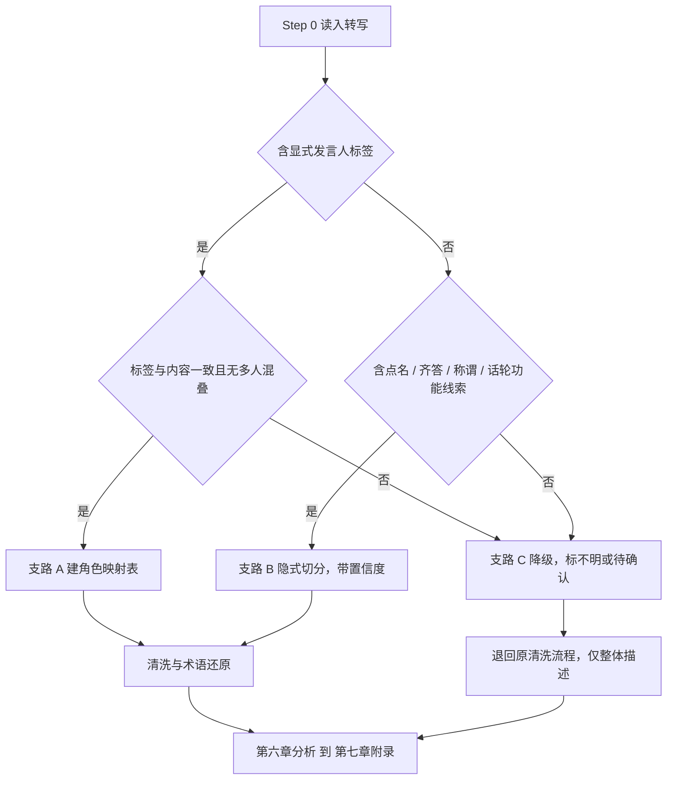

# 录音发言人区分与课堂话语分析规范

> 供技能 **Step 0「输入质量评估与预处理」** 用指针引用，不替代原清洗流程；支路结论写入报告附录边界声明。本文件只回答「谁说了什么、判断多可靠、用于报告哪一步」。
> 全程不产出评分、等第、排名，只用质性三档（充分／部分／未见）；置信度（高／中／低／待确认）只表示可追溯程度。

## 0. 事实纪律

1. 所引话语只出自一份**已核实**转写：小学二年级数学《认识厘米及测量应用》，新授课，背景为使用智慧教育平台。格式 `[HH:MM:SS.mmm] + 连续文本`，**无发言人标签**；学生仅在教师点名时以「姓名。」出现在教师话语中，齐答与个体回答混排同一段落。不得假定输入带标签。
2. 引文保留原貌；清洗稿、还原词另列，不得冒充原话写入附录 A。
3. **不预设平台能力**（自动分离说话人、说话人日志、人次统计等）；切分只是对**已有文本**的线索推断，材料未写即写「记录中未观察到」。
4. 不虚构内容、不补写教学行为、不硬猜身份；听不清、错字、归属矛盾处标置信度或「待确认」。
5. 示例姓名仅演示点名线索；交付报告按第七章脱敏，呼应 ❌20。

---

## 一、定位与三条支路总览

产物：支路判定、角色映射表、轮次底稿、还原清单；下游：Step 2 思维五证据、Step 3 WISE、附录 A、循证四视角、议课发问。不做声学确认与重叠分离。

| 支路 | 判定条件 | 处理 | 允许深度 |
|------|----------|------|----------|
| **A 显式标签** | 有稳定标签，与内容一致、无多人混叠 | 按标签建映射表 | 完整发言人级分析 |
| **B 隐式切分** | **无标签**，但有点名、齐答、称谓线索（本样例属此） | 按第四章切**推定话轮**，逐条带置信度 | 带边界声明的分析，写「推定」 |
| **C 降级** | 无标签且无线索；或标签不可靠、多人混叠 | 退回 Step 0 原清洗流程，标「不明」 | 仅整体描述，**不做发言人级分析** |

> 支路结论留痕于边界声明；一份记录只判一次，局部无线索标「不明」。

---

## 二、输入格式兼容表

> 样例列话语均摘自第 0 节真实片段或首句截取，只增删前缀演示格式；`<…>` 为占位符。

| 编号 | 形态 | 格式样例 | 解析要点 | 支路 |
|------|------|----------|----------|------|
| ① | `发言人1/2` | `发言人1：起立到如州，Kim老师，你好，同学们好……` | 标签无角色信息，按四源推定 | A |
| ② | `SPEAKER_00/01` | `[00:00:52.180] SPEAKER_00：……哪个枝条长，哪个枝条短呢？` | 编号顺序不等于角色顺序 | A（复核） |
| ③ | `教师/学生A` | `教师：同意吗？`／`学生A：同意` | 查「学生A」是否被当齐答容器 | A |
| ④ | 角色＋时间戳 | `[00:27:03.570] 教师：那谁来说说在测量的用尺子测量的时候要注意什么呢？` | 分清段落级与话轮级时间戳 | A（复核） |
| ⑤ | 姓名／化名作标签 | `学生B：<话语文本>` | 作标签与作**点名线索**不同；本样例姓名只在教师话语内部 | A 或 B |
| ⑥ | **本样例型：时间戳＋连续文本，无标签但含点名与齐答** | `[00:00:52.180] ……杨佳颖。黄色的枝条短，红色的枝条长，同意吗？同意……李志浩。` | 单段落多人混排；点名／齐答／称谓为线索；段落级时间戳 | **B** |

三个坑：「姓名。」当标签；误识称谓当多位教师（4.5）；段落级时间戳推算候答时间（6.1）。

---

## 三、发言人角色映射表

### 3.1 依据四源

| 源 | 看什么（线索实例见 4.2） |
|----|--------|
| 自称与被称呼 | 谁称「孩子们／同学们」、谁以「老师」自称 |
| 话轮功能 | 谁指令、点名、讲授、评价；谁应答、说明思路 |
| 内容特征 | 组织性话语 vs 直接应答、推理词 |
| 话轮位置 | 紧接点名、紧接征询语、段落起始 |

### 3.2 映射表（字段：标签／推定角色／置信度／依据／待确认说明）

| 标签／线索 | 推定角色 | 代称 | 置信度 | 依据 | 待确认说明 |
|------------|----------|------|--------|------|------------|
| `如州／Kim老师／洛洛老师／露露老师／骆老师` | 同一位教师（归一） | 教师T | 中 | 自称＋功能跨段落稳定 | 是否同一人 |
| `孩子们／同学们` | 学生群体 | 全班 | 高 | 称呼＋内容特征 | 不指向个体 |
| 「杨佳颖。」及后接判断句 | 被点名学生 | 学生A | 中 | 位置＋应答特征 | 点名不等于发言 |
| 段末「李志浩。」 | 被点名学生 | 学生B | 待确认 | 仅位置一条线索 | 本段未见答句 |
| 「李佳玲，你说拿话筒过来。」及解释句 | 被点名学生 | 学生C | 中 | 点名＋「因为」话语 | 解释段归属 |
| 「萱萱。」／`SPEAKER_00`（支路 A） | 不明／教师 | 待确认／教师T | 低／高 | 仅位置／多源一致 | 昵称不与全名合并 |
| 「同意」「可以」「找对了」等短应答 | 学生群体齐答 | 全班（齐答） | 高 | 内容＋位置＋齐答标记 | 不折算个体达成 |
| 「……嗯。一掌住的集合在这儿……」 | 不明 | 不明 | 待确认 | 无线索且转写存疑 | 不凭语气猜角色 |

### 3.3 置信度规则与一次性确认

| 置信度 | 条件 | 写法 |
|--------|------|------|
| 高 | 四源中三源一致且无矛盾 | 「记录显示……」（仍非声学确认） |
| 中 | 两源一致或单源线索明确 | 「推定为学生A，依据为……」，不省「推定」 |
| 低 | 仅单源弱线索 | 「暂记待确认」，不计个体发言 |
| 待确认 | 线索矛盾、转写存疑、称谓无法归一 | 并列保留可能，不二选一 |

歧义**汇总成一次**提问（先出示原话与时间戳）：教师称谓是否同一人；「萱萱。」与全名是否同一人；解释段归属；段末点名是否续接。未回复按「待确认」继续。

---

## 四、隐式切分规则（核心）

### 4.1 底稿字段

`段落时间戳 | 序号 | 话语原文（不清洗） | 推定角色 | 代称 | 话轮功能 | 置信度 | 依据 | 待确认说明`；原文列保留错字与语气词。

### 4.2 六条规则

| 规则 | 真实形态 | 切分动作 | 边界与禁忌 |
|------|----------|----------|------------|
| **① 点名触发** | 「杨佳颖。」「李志浩。」「刘子怡。」「萱萱。」「苏宁浩，」「李佳玲，你说拿话筒过来。」「郑子龙，你说拿话筒。」「何千宇，你说。」等 | 姓名（含昵称、问号式征询）视为**教师点名动作**；紧接应答句切为被点名学生（推定），止于下一教师功能标志 | 点名非发言；「你说拿话筒过来」属教师指令；段末不补答句 |
| **② 称谓与自称** | 「孩子们」「同学们」「那洛洛老师也想来量」 | 判为教师话轮起止标志；误识名按 4.5 归一 | 不据称谓数量推断教师人数 |
| **③ 齐答识别** | 「同意吗？同意」「一起说」「大声的告诉我」「大家同意吗？同意」「找对了没有？找对了，把掌声送给他们」 | 征询／指令后紧接短应答标「全班（齐答）」单独成行，写出触发原句 | **不记为个体达成**，不计个体次数 |
| **④ 话轮功能** | 教师：讲授／指令／点名／追问／评价／复述；学生：回答／提问／说明思路 | 按功能而非句长：「不能斜着放的意思就是我们要把尺子放平放正」是教师复述；含「因为」的解释句为说明思路 | 复述与应答相邻须分行 |
| **⑤ 多段落合并** | `如州／Kim老师／洛洛老师／露露老师／骆老师` → 教师T | 凭「组织—指令—讲授—追问」跨段落稳定归一，写明依据与不确定性 | 昵称与全名不强行合并 |
| **⑥ 置信度随行** | 全规则通用 | 每条推定话轮必填置信度，低置信与矛盾标「待确认」，原话照录 | 禁止硬猜；不得写成「记录显示」 |

### 4.3 切分示例（格式演示，话语均出自真实片段）

**示例 1 · `[00:00:52.180]` 点名→回答→齐答→追问**

| 序 | 话语原文（节引） | 推定角色 | 功能 | 置信度 | 依据／待确认 |
|:--:|------------------|----------|------|--------|--------------|
| 1 | 起立到如州，Kim老师，你好，同学们好，请坐坐如长孩子们…… | 教师T | 组织＋讲授 | 高 | 称谓、位置；误识名见第五章 |
| 2 | 杨佳颖。／黄色的枝条短，红色的枝条长 | 教师T／学生A（推定） | 点名／回答 | 高／中 | 点名非发言；归属待确认 |
| 3 | 同意吗？／同意 | 教师T／全班（齐答） | 征询＋齐答 | 高 | 齐答；不折算个体 |
| 4 | 那红色的纸条究竟比黄色的纸条长多少呢？你有什么好的办法知道结果？ | 教师T | 追问 | 高 | 话轮功能 |
| 5 | 李志浩。 | 教师T | 点名 | 高 | 段末点名，不补答句 |

**示例 2 · `[00:05:50.330]` 多轮追问＋归属存疑**

| 序 | 话语原文（节引） | 推定角色 | 功能 | 置信度 | 依据／待确认 |
|:--:|------------------|----------|------|--------|--------------|
| 1 | 谁还想再来让一点？刘子怡。 | 教师T | 提问＋点名 | 高 | 点名句式，不切给学生 |
| 2 | ……嗯。一掌住的集合在这儿…… | 不明 | 不明 | 待确认 | 转写存疑；不推断示范动作 |
| 3 | 那洛洛老师也想来量，可不可以啊？／可以 | 教师T／全班（齐答） | 征询＋齐答 | 中 | 教师自称；是否齐答须确认 |
| 4 | 那那你们帮我数。一眨。 | 教师T／齐答（待确认） | 指令＋应答 | 待确认 | 「一眨」存疑，不还原动作 |
| 5 | 为什么同样的一个纸直条，我们用同样的一掌量出来的结果却不一样呢？ | 教师T | 因果追问 | 高 | 附录 A 可取证 |
| 6 | 李佳玲，你说拿话筒过来。／因为洛洛老的洛洛老师的手比我们的手大，每个人的手的大小不一样 | 教师T／学生C（推定） | 点名／说明思路 | 高／中 | 含「因为」＋紧接点名 |

`[00:27:03.570]`「不能斜着放的意思就是我们要把尺子放平放正」「大家同意吗？同意」可套用规则①④。`[00:09:20.030]`「萱萱。马化筒上面有数字，而且零的后面还有一个C和一个么？」、`[00:29:10.980]`「能你来跟大家说一下，拿话筒。我可以嗯对准一以后……」、`[00:34:54.400]`「郑子龙，你说拿话筒。大家听我说……」同理；只作格式演示，不补写教学行为。

---

## 五、转写清洗与术语还原纪律

**顺序不可颠倒**：留底→切分后剥离时间戳、语气词（「嗯」「呃」）、重复口语（「那那」「他就他就」），**保留点名、称谓、齐答标记与「因为」等线索词**→按学科常识还原术语并标「已还原（推定）」，原文与还原文并列。先清洗会抹掉齐答线索。

| 转写原貌 | 建议还原 | 标注 | 使用限制 |
|----------|----------|------|----------|
| 一妥 | 一庹 | 已还原（推定） | 不补写示范动作 |
| 一掌／一扎／一拃（混用） | 一拃（并列保留） | 已还原（推定）／待确认 | 不归一为同一动作 |
| 如州／Kim老师／洛洛老师／露露老师／骆老师 | 教师T | 已归一（推定） | 不作在场人数事实 |
| C和一个么 | cm | 已还原（推定） | 不改原话列 |
| 客户线／色度 | 刻度线／刻度 | 已还原（推定） | 不补写讲解行为 |
| 大约是一米 | 一厘米 | 已还原（推定） | 不得当作学生真实回答 |
| 马化筒 | 话筒（相关误识） | 已还原（推定）／待确认 | 不推断设备使用 |
| 枝条 | 纸条 | 已还原（推定） | 不推断教具操作 |

**四条硬纪律**：①ASR／OCR 错字不得当事实（不得由「大约是一米」推断学生概念）；②严禁脑补教学行为（不得由「……嗯。一掌住的集合在这儿……」补写具体动作，只写「记录中未观察到可归属的行为」）；③还原只作可读化；④齐答与个体分开计，附录 A 只放原话。

---

## 六、课堂话语分析指标

> 每项写「分析什么／落到环节／输出什么」；输出为事实描述与质性三档（充分／部分／未见），附证据。

| 指标 | 分析什么 | 落到技能哪个环节 | 输出什么 |
|------|----------|------------------|----------|
| **① 话轮结构：IRF vs 多轮建设性对话、候答时间** | IRF 闭环；思路是否被追问 | WISE I／S 层；循证四视角；议课发问 | 轮次概览＋「IRF 为主／出现多轮追问」描述；候答时间写「记录不支持候答时间估算」 |
| **② 学生个体参与画像** | 谁被点名、谁有答句、几次、是否被回应、谁未见 | Step 2 学习状态／差异；E 层；五证据 | 画像表：代称／答句与次数／是否被回应／齐答（不折算）／未见项；不排序比较 |
| **③ 学生原问归属** | 疑问与反问出自谁 | 附录 A 提问质量 | 「原问—发言人（或『待确认』）—上下文」三列；支路 B 写「学生（推定，待确认）」；支路 C 写「记录不支持发言人级分析」 |
| **④ 观点碰撞追踪** | 观点由谁提出、被谁迭代 | 思维五证据之观点碰撞 | 「谁→谁」链条表；`[00:05:50.330]`「为什么同样的一个纸直条……却不一样呢？」→「因为……每个人的手的大小不一样」→「那要得到同样的结果该怎么办呢？」连成待确认链 |
| **⑤ 齐答／小组代表／个体发言区分** | 三类形态分别标记 | Step 2 学习关系；E 层；误区核查 | 分类清单：齐答／小组代表（未见写「记录中未观察到」）／个体发言（含代称与置信度）；齐答不作全体达成证据 |
| **⑥ 学科话语观察点** | 证据词、推理词、单位语言、目标语、规则表述 | 思维五证据之表达逻辑；WISE S 层；课型标尺 | 观察表：话语类型／原话摘句／发言人／置信度／质性三档＋证据；学科卡未加载写「未见学科卡」 |

**学科卡加载**：Step 1 确认学科后按 `references/discipline_expert_cards.md` 加载学科卡；未覆盖学科不套用，只保留通用观察并写入边界声明。学科话语只描述**话语形态**。

| 学科 | 观察什么 | 本记录可对应形态 |
|------|----------|------------------|
| 物理 | 「因为／数据表明／控制变量」等证据词 | 不套用 |
| 语文 | 是否引用文本语句作依据 | 不套用 |
| 数学 | 「因为／所以／几个一厘米」等推理与单位语言 | `[00:05:50.330]`「因为……每个人的手的大小不一样」为含「因为」的说明思路；`[00:29:10.980]`「然后再减一就知道它是几了」为推理链。「五个一厘米就是五厘米」见于编制说明，**未逐字见于所附转写片段，引用前须回原始录音核准，未经核准只作话语类型示例** |
| 英语 | 目标语输出情形，作质性描述，不产出数值比例结论 | 不套用 |
| 信息科技 | 「分解／算法／规则」等表述 | 不套用 |

---

## 七、报告输出规范

### 7.1 完全版新增附录「课堂话语与发言人分析」

> 附录编号按主文档 SKILL.md 为 **I**（G 为课标核心素养达成对照、H 为学科评课标准对照）。四表须填具体内容，不留占位符；无内容如实写「记录中未观察到」或「记录不支持发言人级分析」。

| 表 | 列名 | 填写规则 |
|----|------|----------|
| **I-1 角色映射表** | 标签（脱敏）／推定角色／置信度／依据四源／待确认说明 | 含「不明」「待确认」均需置信度 |
| **I-2 话语轮次概览** | 序号／时间节点／话语摘句（脱敏）／话语类型／推定发言人／置信度／证据用途 | 类型限：讲授／指令／提问／点名／评价／复述／回答／齐答／不明；注明段落级 |
| **I-3 学生参与画像** | 代称／答句摘句与次数／是否被回应／齐答参与（不折算）／记录中未见项 | 不排序比较；无答句写「本段未见答句」 |
| **I-4 边界声明** | 支路／时间戳粒度／无法判断项／报告标注语／待确认事项 | 写判定依据、未确认条目、还原清单、学科卡加载情况 |

### 7.2 简版一句话（择一，不展开表格）

| 支路 | 句子 |
|------|------|
| A | 「记录含稳定发言人标签，附录 I 给出角色映射与轮次概览，学生原问与齐答分列。」 |
| B | 「本记录为无标签连续转写，按点名与齐答线索隐式切分，发言人均为带置信度的推定；详见附录 I。」 |
| C | 「本记录无标签且缺少线索，按原清洗流程处理并标注『不明』，不出具发言人级分析。」 |

### 7.3 隐私代称（呼应 ❌20）

| 原记录形态 | 报告呈现 | 说明 |
|------------|----------|------|
| 点名中的真实姓名 | 学生A／学生B／学生C（按首次点名顺序） | 正文、附录 I、议课方案一律用代称；不出现真实姓名、学校名 |
| 教师误识称谓 | 教师T | 不还原真实姓名 |
| 齐答／归属不明 | 全班（齐答）／不明·待确认 | 不拆解为个体，不补写 |
| 平台、设备名称 | 按 ❌20 脱敏或不写 | 只描述可观察到的话语 |

### 7.4 「记录不支持发言人级分析」如实标注

支路 C 写「未含点名、齐答、称谓等线索，相关内容标『不明』」；支路 B 写「话轮为文本线索推定，置信度见 I-2」；标签不可靠／混叠写「已停用该标签，不做发言人级分析」；时间戳不足写「段落级时间戳不支持候答时间估算」。

---

## 八、降级纪律与禁区

| 触发 | 动作 | 标注 | 最小可用输出 |
|------|------|------|--------------|
| 无标签且全文无点名、齐答、称谓线索 | 退回 Step 0 原清洗流程（剥离时间戳／语气词、术语还原、按教师活动与学生反应两线重组） | 不明 | 整体话语脉络、原话摘句、边界声明 |
| 显式标签与内容反复矛盾 | 停用标签，按无标签重判 | 待确认 | 同上；不生成角色映射表 |
| 同一标签／段落混入多人话语且无法拆开 | 不拆分、不指派 | 不明／多人混叠 | 只写「该段落含多方话语」，不计个体参与 |
| 转写残缺到点名与齐答句式不可辨 | 不强行生成发言人表格 | 记录不支持发言人级分析 | 按主文档「输入质量不足」输出《观察提问清单》 |

> 降级不等于停做评课：整体话语仍可支撑 WISE 结构层与策略层分析，只是不得写「谁回应了谁」。

**禁区**：①凭语气猜角色并补写话语；②用齐答冒充全体达成或折算个体发言（呼应三个常见误区）；③把话语分析写成量化评价、等第、名次或比较——本技能**零分数零等级**，只用质性三档并紧跟证据；④把 ASR／OCR 错字当事实、由错字反推行为；⑤把「记录中未见」写成「该生未参与」；⑥把点名等同于实际发言；⑦虚构平台自动分离等能力；⑧把低置信度推定写成确定陈述或省略「推定」；⑨把还原稿混入附录 A 实例列；⑩硬拆、硬编号、硬合并昵称。

---

## 九、自检清单

| □ | 检查项 | 通过标准／未通过动作 |
|:--:|--------|----------------------|
| □1 | 三条支路齐全 | 已判 A／B／C 并写入 I-4 |
| □2 | 映射表置信度齐全 | 每个标签有置信度与四源依据 |
| □3 | 无硬猜 | 无「凭语气判断」；存疑处均待确认 |
| □4 | 附录有数据 | I-1 至 I-4 均有原话与依据；无数据按 7.4 标注 |
| □5 | 降级分支如实标注 | 支路 C 与局部「不明」已标「记录不支持发言人级分析」 |
| □6 | 隐私已脱敏 | 无真实姓名、学校名；一律学生A/B/C、教师T、全班（齐答） |
| □7 | 无分数 | 无评分、等第、排名；只出现质性三档与置信度 |
| □8 | 引文可追溯 | 课堂语句均出自第 0 节真实片段；还原词标「已还原（推定）」 |
| □9 | 齐答单列与学科卡 | 齐答未计入个体次数；已标注学科卡加载 |

> 本文件不改变技能的评价伦理与产出纪律：事实与判断分列，只用质性三档并紧跟证据。
